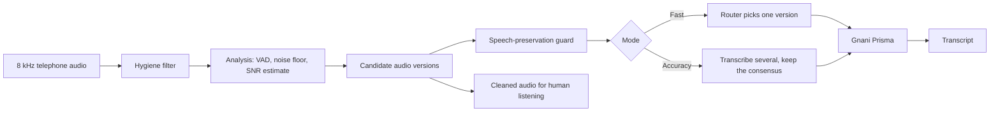

<!--
BEFORE YOU PUBLISH (delete this block):
1. Every cell that says TBD must be replaced with a number from results/*.csv, or the row deleted.
   Do not publish invented or rounded-up numbers. Gnani disqualifies misleading demos.
2. Search this file for FILL and resolve each one (links, names, script names).
3. Delete every block between a "CUT IF NOT SHIPPED" marker and its "END CUT" marker for features you did not finish.
4. Rewrite "Findings" and "Limitations" so they match what your data actually showed.
5. Rename this file to README.md in the repo root.
-->

# BharatNoisePrism

**An ASR-aware front-end for noisy Indian telephone audio, built on Gnani Prisma, with an honest measurement of what pre-processing actually does to transcription accuracy.**


Submission for the **Noise Canceller Award**, [Great Indian AI Internship Challenge](https://www.gnani.ai/internship) by Gnani.ai.

- Demo video (60 s): FILL link
- Public post: FILL LinkedIn / X link
- Written explanation: this README

---

## The result in one table

Word error rate (WER, lower is better) with Gnani Prisma on **real telephone audio**, comparing the raw call against BharatNoise. Numbers come from `results/final_results.csv`; the 95% interval is a paired bootstrap over clips.

| Prisma model | Raw audio WER | BharatNoise WER | Change (95% CI) | Clips better / same / worse |
| ------------ | ------------- | --------------- | --------------- | --------------------------- |
| v2.5         | TBD           | TBD             | TBD             | TBD                         |
| v3.0         | TBD           | TBD             | TBD             | TBD                         |

Test set: TBD clips, TBD languages, TBD noise conditions. API run-to-run noise floor on identical audio: TBD WER points (changes smaller than this are not treated as real).

---

## The problem

Telephone speech is narrowband (8 kHz), compressed, and recorded in the places people actually call from: traffic, crowds, markets, fans, bad lines. Speech recognition errors in these conditions are what callers and businesses feel.

The obvious fix is to clean the audio before transcription. The research literature and our own measurements say the obvious fix is risky: noise suppression can distort speech and **increase** recognition errors, especially for ASR models already trained on noisy telephone audio.

## The idea

BharatNoise does not assume denoising helps. For each call it decides how much cleaning to apply, checks that the cleaning is not eating speech, and falls back to the original audio when cleaning would hurt. Then it measures the effect on Gnani Prisma's transcripts.

Prior work this builds on, in our own words:

- Iwamoto et al. ([arXiv:2201.06685](https://arxiv.org/abs/2201.06685)) analyse how speech enhancement artifacts degrade ASR, and show that mixing a scaled copy of the original signal back into the enhanced audio helps recognition.
- Sato et al. ([arXiv:2201.03881](https://arxiv.org/abs/2201.03881)) switch between enhanced and observed signals based on estimated conditions.

**What is ours** is not a new algorithm. It is a complete, reproducible study of this approach with a **black-box, API-only** ASR (Gnani Prisma), on Indian languages and Indian noise, with confidence intervals and the failures included.

## How it works



**Candidate versions of each clip**

| ID  | What it is                                                                                                       | Why it exists                                                     |
| --- | ---------------------------------------------------------------------------------------------------------------- | ----------------------------------------------------------------- |
| C0  | Original audio                                                                                                   | The baseline every other version must beat                        |
| C1  | Hygiene only: DC removal, 300-3400 Hz band-limit, mains-hum notch, gain normalisation                            | Cheap and rarely harmful                                          |
| C2  | Conservative Wiener / spectral-gating suppression, blended with the original: `y = enhanced + lambda * original` | Keeps speech cues that aggressive suppression destroys            |
| C3  | Neural enhancement (DeepFilterNet, resampled 8 -> 48 -> 8 kHz)                                                   | Strongest cleaning; used for listening and tested as an ASR input |

**Speech-preservation guard.** On speech frames (found with a voice-activity detector), the guard compares the original and enhanced audio in the telephone band. If the enhancer removed too much speech energy or distorted the spectrum, it raises the blend weight or falls back to C1. We report whether the guard's score actually tracks the change in WER (see Findings).

**Modes**

- **Fast** (1 API call): thresholds on the estimated SNR pick one version. Thresholds are fitted on the development set only.
- **Accuracy** (several API calls): transcribe C0, C1 and C2 (and optionally both Prisma models), then keep the transcript closest to all the others, measured by pairwise word edit distance. This needs no confidence scores, which Prisma's REST API does not return. It costs more calls and latency; we report both.

<!-- CUT IF NOT SHIPPED -->

- **Live** (demo only): streams audio to Prisma over WebSocket in exact 64 ms frames (512 samples at 8 kHz) through a backend proxy, using the telephony VAD preset.

<!-- END CUT -->

**Design note: why not phase inversion?** Anti-noise cancellation, as in noise-cancelling headphones, needs a reference noise signal at the listener. A single recorded call has no such reference, so the noise has to be estimated, and no estimate is perfect. We therefore use gain-based suppression with blending and measure the outcome, rather than claiming physical cancellation.

## Gnani models used

| Gnani technology          | How we use it                                                                                   |
| ------------------------- | ----------------------------------------------------------------------------------------------- |
| **Prisma v2.5** (primary) | REST transcription for the benchmark; explicit `model=prisma-v2.5`, `format=verbatim`           |
| **Prisma v3.0**           | Same benchmark as a second model; language detection and mixed-language handling where relevant |
| Realtime streaming API    | Live demo path (if shipped)                                                                     |

Languages tested: FILL (e.g. Hindi `hi-IN`, Kannada `kn-IN`, Indian English `en-IN`). Prisma supports ten Indian-language codes in total, and the harness takes the language per clip from a manifest.

## Evaluation

**Data**

| Set            | Source                                                                                                                                                                          | Purpose                                                     |
| -------------- | ------------------------------------------------------------------------------------------------------------------------------------------------------------------------------- | ----------------------------------------------------------- |
| Real telephone | FILL: e.g. a subset of [GramVaani Hindi](https://openslr.org/resources/118/about.html), 8 kHz-native clips, 15 s or shorter                                                     | Headline result on genuinely noisy telephone speech         |
| Controlled     | FILL: e.g. [IndicVoices](https://huggingface.co/datasets/ai4bharat/IndicVoices) validation clips, mixed with noise at 0, 5 and 10 dB SNR, then passed through a telephone codec | Known clean references; clean SNR and noise-type breakdowns |
| Noise          | FILL: our own street and traffic recordings, plus public noise corpora (licences checked)                                                                                       | Indian traffic and horn noise                               |

**Protocol**

- Development and test sets are speaker-disjoint. All thresholds and blend weights are frozen on development data before the test set is touched.
- Every response is cached. We transcribed the original audio twice to measure Prisma's own run-to-run variation before interpreting any difference.
- Text normalisation and scoring conventions are documented at the top of [`metrics.py`](metrics.py).
- Differences are reported as paired bootstrap 95% intervals plus per-clip win / tie / loss counts, not as bare averages.

**Primary metric:** WER. **Secondary:** CER, per-clip wins and losses, latency (p50 / p95) per mode. SNR gain and SI-SDR are computed on synthetic mixtures only, where a clean reference exists.

### Results

**By noise type (controlled set, Prisma v2.5)**

| Noise            | Raw WER | Best BharatNoise WER | Change (95% CI) |
| ---------------- | ------- | -------------------- | --------------- |
| Traffic / horns  | TBD     | TBD                  | TBD             |
| Crowd / babble   | TBD     | TBD                  | TBD             |
| Indoor (fan, TV) | TBD     | TBD                  | TBD             |
| Channel damage   | TBD     | TBD                  | TBD             |

**By SNR**

| SNR   | Raw WER | BharatNoise WER | Change (95% CI) |
| ----- | ------- | --------------- | --------------- |
| 10 dB | TBD     | TBD             | TBD             |
| 5 dB  | TBD     | TBD             | TBD             |
| 0 dB  | TBD     | TBD             | TBD             |

**Ablation: what contributes**

| System                    | WER | Change vs C0 (95% CI) |
| ------------------------- | --- | --------------------- |
| C0 original               | TBD | n/a                   |
| C1 hygiene only           | TBD | TBD                   |
| C2 blended suppression    | TBD | TBD                   |
| C3 neural only            | TBD | TBD                   |
| Fast router               | TBD | TBD                   |
| Accuracy mode (consensus) | TBD | TBD                   |
| Fast router, guard off    | TBD | TBD                   |

**Latency**

| Mode     | p50 | p95 | API calls per clip |
| -------- | --- | --- | ------------------ |
| Fast     | TBD | TBD | 1                  |
| Accuracy | TBD | TBD | TBD                |

### Findings

FILL: three to five sentences written from your numbers. Say plainly where each component helped, where it did not, and what the guard did. Include at least one clip where cleaning made things worse and what the system did about it.

### Limitations

- The test sets are small (TBD clips), so intervals are wide, particularly per noise type and per language.
- GramVaani transcripts are crowd-sourced with uneven accuracy, so we compare systems relative to each other and do not claim absolute error rates. Gnani has cited GramVaani in its own benchmarking, so Prisma may have seen similar audio.
- Synthetic mixtures with a codec simulation are not real calls. The real-telephone set is the headline for that reason.
- Prisma's REST endpoint resamples to 16 kHz server-side, so we cannot isolate any 8 kHz-specific effect there.
- Accuracy mode multiplies API calls and latency by the number of candidates.
- Code-mixed (Hinglish) speech is shown qualitatively only; a reliable quantitative score needs a script convention for references that we did not have time to validate.
- FILL: anything else you observed.

## Data and privacy

No real customer calls, phone numbers, account numbers, Aadhaar, PAN or other personal data are used anywhere in this project, in line with the challenge FAQ. Evaluation uses public research corpora (licences below), clips we synthesised, and scripted staged calls recorded by the team with consent. Public-corpus audio is **not redistributed** in this repository; scripts download it from the original source.

| Corpus              | Licence / terms                                                      | Notes                    |
| ------------------- | -------------------------------------------------------------------- | ------------------------ |
| FILL: GramVaani     | Research use free; commercial use needs an agreement with Gram Vaani | Check terms before reuse |
| FILL: IndicVoices   | CC BY 4.0                                                            |                          |
| FILL: noise sources | Per-source licence                                                   | Own recordings are ours  |

## Reproduce it

```bash
git clone FILL-your-repo-url && cd FILL-repo-name
pip install -r requirements.txt
export GNANI_API_KEY=your-key          # PowerShell: $env:GNANI_API_KEY="your-key"
pytest -q                              # unit tests; they never call the real API

# 1. Build the evaluation sets (downloads public corpora, mixes noise, applies the codec)
python scripts/build_eval_set.py FILL-args

# 2. Transcribe each candidate version with Prisma (serial calls, cached, resumable)
python run_baseline.py --manifest data/real_C0.csv --model v2.5 --tag real_C0_v25
python run_baseline.py --manifest data/real_C2.csv --model v2.5 --tag real_C2_v25

# 3. Measure Prisma's own run-to-run noise on identical audio
python run_baseline.py --manifest data/real_C0.csv --model v2.5 --tag real_C0_v25_run1 --run-id 1
python compare.py results/real_C0_v25.csv results/real_C0_v25_run1.csv

# 4. Compare a candidate with the baseline, with per-group breakdown
python compare.py results/real_C0_v25.csv results/real_C2_v25.csv --by group
```

Calls are strictly serial because Gnani's API limits accounts to one active request. Clips must be 30 s or shorter for REST. Re-running a command costs nothing for clips already cached.

### Every claim, and where to check it

| Claim                                       | File                                                      | Command                              |
| ------------------------------------------- | --------------------------------------------------------- | ------------------------------------ |
| Headline WER change on real telephone audio | `results/final_results.csv`                               | FILL                                 |
| Prisma run-to-run noise floor               | `results/real_C0_v25.csv`, `results/real_C0_v25_run1.csv` | `python compare.py` on the two files |
| Ablation table                              | `results/ablation_results.csv`                            | FILL                                 |
| Latency                                     | FILL                                                      | FILL                                 |

## Repository layout

```text
FILL-repo-name/
├── README.md
├── requirements.txt
├── gnani_client.py      # Prisma REST client: serial calls, backoff, cache, 30 s guard
├── metrics.py           # normalisation, WER / CER, paired bootstrap
├── run_baseline.py      # manifest -> results CSV
├── compare.py           # two results CSVs -> delta with 95% CI
├── test_harness.py      # unit tests with a fake local API server
├── audio/               # FILL: hygiene, suppression, blend, guard, router, consensus
├── scripts/             # FILL: evaluation-set builder
├── app/                 # FILL: demo UI and streaming proxy
├── results/             # CSVs behind every number above
└── examples/
```

## Demo

FILL: one paragraph on what the demo shows (original versus cleaned audio, transcript diff, scoreboard, and one case where cleaning did not help), plus the video link.

## Team and contributions

| Name | Contribution |
| ---- | ------------ |
| FILL | FILL         |

## Roadmap

- Validate scoring for code-mixed speech and add a quantitative Hinglish result.
- Extend the real-telephone test set to more languages and more speakers.
- Learn the routing decision from data instead of using thresholds.

## References

- Iwamoto et al., speech enhancement artifacts and ASR, [arXiv:2201.06685](https://arxiv.org/abs/2201.06685)
- Sato et al., switching between enhanced and observed signals, [arXiv:2201.03881](https://arxiv.org/abs/2201.03881)
- Gnani.ai [API documentation](https://docs.gnani.ai)
- Great Indian AI Internship Challenge: <https://www.gnani.ai/internship>

## Licence

MIT (change if you prefer). Gnani Prisma is a Gnani.ai product; this project is an independent entry to their challenge and is not affiliated with or endorsed by Gnani.ai.
